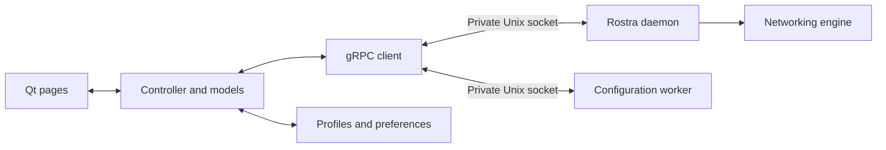

# Development

Sawfish is a C++17 Qt Widgets client for Rostra's desktop daemon. The GUI owns
the core and configuration worker; networking must stop when Sawfish exits.
Linux is the primary development platform. CI also targets Windows amd64 and
arm64. macOS needs a backend implementation before it can join that matrix.

- [Build and run](#build-and-run)
- [Source layout](#source-layout)
- [Backend and lifecycle](#backend-and-lifecycle)
- [Application behavior](#application-behavior)
- [Core updates](#core-updates)
- [CI and releases](#ci-and-releases)
- [Testing](#testing)
- [Remaining work](#remaining-work)
- [Licensing](#licensing)

## Build and run

Use CMake 3.19+, a C++17 compiler, Ninja, Python 3, Qt 6.5+ with
Core/Gui/Widgets/Network/SVG/Test, Protobuf, gRPC C++ (including `protoc` and
`grpc_cpp_plugin`), and the Go toolchain required by the Rostra checkout.
Use matching Protobuf and gRPC libraries and generators.

[`proto/REVISION`](../proto/REVISION) records the Rostra repository and RPC API
version. Both build scripts accept any source commit with byte-identical copies
of the three vendored protocol files and verify the built core's JSON version/API.
Unrelated Rostra commits require no Sawfish metadata changes. Local core
modifications are allowed for development; CI requires a clean checkout. Review
and copy changed protocol definitions when updating the API.

### Linux

On Arch, the build packages include `base-devel cmake ninja python qt6-base
qt6-svg protobuf grpc go`; packaging also needs `patchelf`. From the Sawfish root,
create a sibling Rostra checkout if one does not already exist:

```sh
git clone --branch testing https://github.com/fig0ut/rostra ../rostra
./scripts/build.sh
ctest --test-dir build --output-on-failure
./scripts/run-dev.sh
```

The build produces `build/sawfish` and `build/rostra-daemon`. The development
launcher uses `build/dev-runtime/client` for profiles, preferences, and core
state. Run `build/sawfish` directly to use the normal application data location.
The adjacent core is discovered automatically; `--backend` and `--data-dir`
provide development overrides. Settings → Advanced also has an executable
override. Socket paths are managed internally.

An optional workspace-local gRPC prefix at `.deps/grpc/usr` is recognized by
the build and development scripts. When using it, direct test or executable
invocations also need its shared libraries:

```sh
LD_LIBRARY_PATH="$PWD/.deps/grpc/usr/lib${LD_LIBRARY_PATH:+:$LD_LIBRARY_PATH}" \
    ctest --test-dir build --output-on-failure
```

### Windows

Use Visual Studio's developer PowerShell with MSVC, native Go, matching Qt
libraries, and **gRPC C++ 1.84+ built with MSVC**. Use a Windows version supported
by that Qt build; the socket transport also requires Windows 10 1803 or later.
MinGW's gRPC transport does not support this native Unix-socket path.

Keep the vendored protocol files byte-identical in both checkouts
(`core.autocrlf=false`). With a compatible Rostra checkout beside Sawfish:

```powershell
./scripts/build.ps1 -PrefixPath 'C:/Qt/6.x/msvc2022_64;C:/dependencies/installed/x64-windows'
ctest --test-dir build --output-on-failure
cmake --install build --prefix dist
```

Replace the example prefixes with your dependency installation paths. For
Windows ARM64, use ARM64 MSVC, Qt, gRPC, and Go dependencies. The executables are
`sawfish.exe` and `rostra-daemon.exe`. Custom dynamic gRPC/Protobuf/OpenSSL builds
may need their runtime DLLs deployed alongside the application; CI builds those
C++ dependencies statically.

### Build configuration

| Setting | Purpose |
| --- | --- |
| `ROSTRA_SOURCE` | Core source path for `scripts/build.sh`; defaults to `../rostra`. |
| `SAWFISH_BUILD_DIR` | Build directory for the shell and CI scripts; use an absolute path. |
| `SAWFISH_BUILD_JOBS` | Parallel build jobs. |
| `ROSTRA_BUILD_TAGS` | Optional core feature override in the development scripts. |
| `CGO_ENABLED` | Optional development override; defaults to `0` for the core. |
| `SAWFISH_TEST_BACKEND` | Absolute core executable path for integration tests. |

The PowerShell script provides `-RostraSource`, `-BuildDirectory`, `-PrefixPath`,
`-BuildType`, and `-Jobs`. Core builds read Rostra's
`release/DEFAULT_BUILD_TAGS_OTHERS` and `release/LDFLAGS`. This matches the
single-executable desktop update format and excludes Naïve's companion Cronet
library. Custom feature tags can require additional libraries.

## Source layout

| Path | Responsibility |
| --- | --- |
| `main.cpp`, `mainwindow.*` | Application entry point, window, navigation, and tray. |
| `app/` | Controller, shared state, and application operations. |
| `backend/` | RPC client, core/worker lifecycle, core updates, and CPU sampling. |
| `models/` | Profiles, outbound groups, connections, logs, and formatting. |
| `pages/`, `widgets/` | Qt pages and reusable themed controls. |
| `proto/` | Vendored RPC definitions and required core API version. |
| `cmake/` | Generated C++ namespace adaptation. |
| `scripts/`, `.github/` | Development commands and build/test/package workflow. |
| `tests/` | Model, RPC, UI, update, and real-process integration tests. |
| `assets/heroicons/` | Icon sources, attribution, license, and checksums. |
| `packaging/` | Desktop launcher, Linux installation checks, and Arch recipe template. |
| `docs/` | This development guide. |

Keep protocol handling and state transitions out of page classes. Model changes
belong on Qt's GUI thread. The RPC client performs cancellable background calls
and streams and delivers bounded, coalesced updates to the controller/models.
Build output, SDKs, downloaded dependencies, runtime data, logs, and personal
editor settings are excluded by `.gitignore`. Commit source, tests,
dependency provenance, and shared build/editor configuration.

## Backend and lifecycle

The GUI uses gRPC over private Unix sockets to Rostra's `experimental/boxdd`
executable. A second invocation provides the configuration worker. The ordinary
Rostra CLI and configured `api` service do not provide the complete desktop
lifecycle interface.



### RPC compatibility

The definitions are `daemon/started_service.proto`, `daemon/managed_service.proto`,
and `experimental/boxdd/desktop_service.proto`; API version 4 is required. Because
the protobuf package `daemon` conflicts with POSIX `daemon()` in C++,
`cmake/namespace_proto.py` changes generated C++ namespace tokens to `rostra_rpc`.
It also removes the Windows `StartService` macro after platform includes in both
the generated desktop RPC header and implementation. Wire descriptors and gRPC
method paths remain unchanged. Non-Windows test builds inject `StartServiceA`
into the generated implementation; the RPC suite injects `StartServiceW` before
including the generated header. Both must link and exchange the same RPCs.

| Operation | Rostra API |
| --- | --- |
| Discover core and claim ownership | `DesktopService.GetDaemonInfo`, `ClaimService` |
| Validate configuration | Worker `ApplicationService.CheckConfig` |
| Apply configuration / connect | `DesktopService.StartService` |
| Stop / reload saved configuration | `ManagedService.StopService`, `ReloadService` |
| Observe lifecycle and traffic | `SubscribeServiceStatus`, `SubscribeStatus`, `GetStartedAt` |
| Select outbound / test delay | `SubscribeGroups`, `SelectOutbound`, `URLTest` |
| Inspect logs and connections | `SubscribeLog`, `SubscribeConnections`, `CloseConnection` |

`ReloadService` does not accept edited configuration content. Routing mode and
system proxy APIs exist in Rostra, but their Sawfish controls remain planned.
Unsupported methods, ownership conflicts, and API mismatches are surfaced
explicitly. After an uncertain command result, reconnect and reconcile state;
do not blindly repeat start/stop or selection commands.

### Process ownership

| Event | Behavior |
| --- | --- |
| Open Sawfish | Start core and worker; verify RPC readiness and ownership. |
| Connect | Validate the selected profile, then start networking. |
| Switch profile while connected | Check new content, then restart the networking instance. |
| Disconnect | Stop networking while keeping the idle core available. |
| Close window | Hide in the tray; without a tray, minimize to the taskbar. |
| Open from tray | Restore the existing window and session. |
| Quit / Ctrl+Q | Cancel pending work, stop networking and both children, then exit. |
| Core crash | Recover with backoff while Sawfish is alive; at most four starts per minute. |
| Sawfish crash | OS parent-death protection terminates its children. |

Retry explicitly resets the restart limit. If the tray disappears while hidden,
the window is restored. No core is launched detached or adopted from another
application. Per-directory locks protect application data and core state; each
launch uses a fresh private socket directory.

`backend/daemonprocess.*` manages the core, readiness, bounded error output,
state lock, and termination deadlines. `Controller` allows 15 seconds for startup
readiness, three seconds for the shutdown RPC, and a five-second core termination
grace period. The worker closes stdin and has a one-second fallback deadline.
Shutdown completes only after both children stop; destructors also clean up.

Linux uses normal `run` and `worker` modes, preserving existing peer authentication
and platform behavior. `backend/ownedprocess.h` uses `PR_SET_PDEATHSIG(SIGKILL)`
and checks the parent-exit race before execution. Normal Quit stops networking
gracefully before terminating the children.

Windows uses `run --owned` and `worker --owned`. Each child joins a non-inheritable
Job Object with `JOB_OBJECT_LIMIT_KILL_ON_JOB_CLOSE` during `CreateProcess`, using
`PROC_THREAD_ATTRIBUTE_JOB_LIST`; failed setup prevents launch. Rostra also
watches its parent process handle and stdin EOF. It verifies the actual parent
PID, matching user/elevation, and socket peer PID (`SIO_AF_UNIX_GETPEERPID`).
Socket/state directories are restricted to the user and SYSTEM; existing
endpoints are rejected. Paths must fit `sockaddr_un`. This uses native Windows
sockets without WSL or a TCP control port. The installed worker's named-pipe
relay/signature checks remain separate from owned mode.

The owned command contract, also implemented and tested on Linux, is:

```text
rostra-daemon run --owned --parent-pid <Sawfish PID> -D <state directory> --socket <absolute socket path>
rostra-daemon worker --owned --parent-pid <Sawfish PID> --socket <absolute socket path>
rostra-daemon version
rostra-daemon check < profile.json
```

Owned commands print `READY`, authenticate only their parent, and stop on parent
exit or stdin EOF. They cannot use TCP listeners or daemon relays and never
install a service. `version` returns JSON such as
`{"version":"1.2.3","api_version":4}`; root `--version` retains text output.
`check` reads at most 4 MiB from stdin, validates without networking, and returns
zero on success or an error and nonzero status on failure.

## Application behavior

### Profiles and validation

Profiles preserve raw text, comments, and unknown fields. File imports use the
filename; collisions get ` (1)`, ` (2)`, etc. Manual renames must be unique. Card
menus offer Select, Edit, and Delete; Select is hidden for the selected profile,
and Update appears when a URL exists. Editing the URL changes only metadata;
Update downloads replacement content into the same profile.

URL imports accept full HTTP/HTTPS configurations, with at most five redirects,
a 2 MiB limit, and a 20-second total deadline. They do not convert subscription
lists or outbound-set documents. Failed downloads preserve existing content;
edits/deletion invalidate stale download and validation results. Cards display
only the source host. Rostra manages remote outbound sets; Sawfish manages full
profile downloads.

Import/save automatically validates, including while disconnected. Invalid
profiles remain editable; green/red/gray markers indicate passed/failed/pending
checks. Profiles are rechecked on launch, and Connect checks the exact selected
content again. Switching or updating an active profile validates before
restarting networking. Failed checks leave the session untouched, but runtime
activation failure can interrupt it. Deleting the active profile stops its
connection first. Profile-activation rollback remains future work.

External local files are not bundled with a profile. Worker validation cannot
guarantee access from the daemon's working directory and restricted file policy.
Preserve that policy when adding asset transfer.

### Outbounds, connections, and charts

Proxies has collapsible groups, searchable cards, confirmed selection, and delay
badges. Arrow keys move focus; Enter/Space selects; T tests delay. Delay testing
does not select a proxy. Acknowledgement and measurements arrive separately,
so the UI waits at most 15 seconds before offering Retry. Automatic and
load-balancing groups permit testing but not manual selection; load balancing
has no single selected member. Refresh reloads the group stream.

Selection is confirmed by stream updates and does not rewrite the profile or
restart networking. Persistence follows Rostra's cache configuration. Group
updates preserve expansion/focus, and stopped sessions disable selection.

Connections supports Active/Closed/All, search, sorting, details, column settings,
and close-selected/close-all. Close all includes filtered-out active connections;
rows change on backend confirmation. Pause freezes display while reception
continues. Reset/delta updates are reconciled before GUI snapshots; at most
10,000 entries are retained, favoring active ones. Column settings support
drag/drop between Shown and Available, reorder, Save/Cancel, and Restore Defaults.
At least one column stays visible; visibility, order, and widths persist.

The dashboard saves a grid layout of movable/resizable widgets: upload speed,
download speed, combined speeds, connections, total traffic, CPU, and memory.
The pen enters edit mode and becomes Save; leaving Home also saves and exits
editing. Keyboard arrows move, Shift+arrows resize, and Delete removes a focused
widget. Idle/new histories use a full-width zero baseline and a 50/50 traffic
ring. Histories reset with the networking session.

Traffic samples are interval deltas; rates use elapsed time, and RPC intervals
use Go duration units (nanoseconds). Respect `trafficAvailable`. CPU samples the
owned Linux process, where 100% represents one core; unsupported measurements
are labeled unavailable. Memory comes from Rostra's status stream.

### Logs and appearance

Logs supports level/text filters, pause, copy, clear, and a saved retention limit
of 100–100,000 lines (default 3,000), also bounded by 2 MiB of text. Lower limits
trim paused buffers too. ANSI escapes and duplicate severity prefixes are removed
before display/filter/copy. App events use `[APP]`, survive core log resets, and
follow the same retention rules. Logs stay in memory until cleared or Sawfish
exits. Only errors show a dismissible toast lasting eight seconds; ordinary
messages go directly to Logs.

Controls and SVG icons follow Qt's palette and display scale. Tray icons reflect
idle, transition, running, or unavailable state, including while hidden.
Validation markers retain their semantic green/red colors. Icons are embedded
through Qt resources; `widgets/icons.cpp` replaces `currentColor` with the
control's palette color and renders at the display's pixel density. Heroicons
attribution and provenance live beside the [bundled assets](../assets/heroicons/README.md).

## Core updates

Settings checks and installs Rostra independently of the GUI; checking alone
does not download or install. Stable selects non-draft releases with
`prerelease=false`; prerelease selects those with `prerelease=true`, without
falling back to stable. Switching the saved channel can select an older version;
Install displays the target. Up to 500 recent releases are examined for the
latest compatible publication.

Downloads come from `fig0ut/rostra`, using raw executable assets:

| Platform | Asset |
| --- | --- |
| Linux amd64 | `rostra-desktop-linux-amd64` |
| Linux arm64 | `rostra-desktop-linux-arm64` |
| Windows amd64 | `rostra-desktop-windows-amd64.exe` |
| Windows arm64 | `rostra-desktop-windows-arm64.exe` |

Ordinary CLI archives are not desktop cores. Releases without a compatible asset
are skipped. Before activation, the updater checks the exact size and GitHub's
SHA-256 digest, JSON `version` (API 4 and matching release version), and `check`
against the running configuration or disconnected selected profile. Received
bytes are hashed locally; no separate checksum file is needed. This relies on
GitHub release security and TLS, not a publisher signature.

Verified executables live in `<application data>/cores/<sha256>/`; the bundled or
running binary is never overwritten. A persistent recovery record saves the
previous selection before switching both children. The updater waits for
core/worker readiness and restores an active session. Activation failure causes
one rollback attempt; interrupted installation restores the previous selection
on restart. Failed rollback is reported, and the previous binary remains
selected for the next launch. Download/check can be cancelled; activation runs
to success or rollback. Quit remains available throughout, and old cores remain
on disk.

Rollback covers executable selection and the session, not arbitrary core-state
migrations. Independent releases must preserve command, JSON version, RPC, and
state compatibility. GUI updates, unattended updates, signatures, old-core cache
pruning, and historical-version selection remain future work.

## CI and releases

The [desktop workflow](../.github/workflows/build.yml) resolves Rostra's `testing`
branch once in the prepare job. Every platform checks out that resolved commit
and bundles the resulting core, which users can later update independently.
The actual commit and version are recorded in `build-info.json`. A new workflow
run can pick up a newer compatible core without changing `proto/REVISION`;
rebuilding an older package requires checking out the commit in its build info.

| Event | Result |
| --- | --- |
| Pull request or push to `main`/`master` | Build, test, package, and retain artifacts. |
| Manual dispatch | Same checks/artifacts, without release publication. |
| Published release, including prerelease | Build the tag; attach packages after every target passes. |

| Target | Native runner | Archive |
| --- | --- | --- |
| Linux amd64 | `ubuntu-24.04` | `.tar.gz`, `.deb`, `.rpm`, `.pkg.tar.zst` |
| Linux arm64 | `ubuntu-24.04-arm` | `.tar.gz`, `.deb`, `.rpm`, `.pkg.tar.zst` |
| Windows amd64 | `windows-2022`, MSVC | `.zip` |
| Windows arm64 | `windows-11-arm`, MSVC | `.zip` |

Packages are named `sawfish-<version>-<os>-<arch>`. Linux bundles target Ubuntu
24.04 and compatible newer systems with X11/XWayland, rather than every Linux
distribution. Windows bundles include Qt deployment and the matching `.exe` core.
Release tags use `vMAJOR.MINOR.PATCH`, optionally with a prerelease suffix;
development versions use the CMake version plus `-dev.<commit>`. Build jobs have
read-only permissions; only release publication has repository write permission
and access to the `linux-release` environment's signing subkey.
Existing Sawfish release assets are not silently overwritten.

[`scripts/ci.py`](../scripts/ci.py) implements the shared pipeline:

1. Read version and `proto/REVISION`; check out Rostra's `testing` branch and verify
   protocol bytes and the required owned command interface in a clean checkout.
   Export its actual commit for all build jobs; reject a different checkout
   within that run. The API version is also checked after building the core.
2. Install Qt **6.8.3** with aqtinstall **3.3.0**. Build gRPC **1.84.0**, pinned by
   commit, with matching Protobuf and dependencies. These C++ libraries are
   static; Qt stays dynamic. Use four parallel compile jobs on hosted runners.
   Save Qt and gRPC caches immediately after each successful installation, so a
   later app build/test failure does not discard them. gRPC cache keys include
   the runner, architecture, compiler version, and
   [`scripts/build_grpc.py`](../scripts/build_grpc.py) recipe; changes to app
   build or packaging logic do not invalidate the dependency cache.
3. Build the core with Go **1.26.10**, Rostra's tags/linker flags, and its Windows
   ARM64 toolchain patch. Check JSON version/API; build the GUI in Release mode.
4. Run every registered CTest suite; skips fail CI. Retain test/build diagnostics,
   including after failures.
5. Stage runtime libraries/plugins, core, documentation, licenses, and
   `build-info.json`. Check ELF/PE architectures, launch the installed GUI without
   the SDK's library/plugin paths, and test IPC against the packaged core.
   Force text output for `--version` so Windows cannot wait on a Qt message box;
   require the expected version within 30 seconds. Bound the packaged-core test
   to 90 seconds and retain its console/text/JUnit output. The packaging step has
   an overall 15-minute limit.
6. Create archives and native Linux packages from the same staged bundle; no
   additional Qt/gRPC builds. CPack creates DEB/RPM packages with automatic ELF
   dependency detection. RPM dependencies exclude privately bundled libraries,
   which are not advertised as system-wide providers. `makepkg` uses the internal
   `packaging/arch/PKGBUILD.in` and local staging tree; no release download is
   needed and no `PKGBUILD` is published. Package architecture names are mapped
   to `amd64`/`arm64` for DEB and `x86_64`/`aarch64` for RPM/Arch.
7. Test installation, upgrade from a synthetic older package, launch as an
   unprivileged user, removal, and user-data preservation in clean Ubuntu 24.04,
   Fedora 44, and Arch environments. ARM uses the official Arch Linux ARM root
   filesystem on the native ARM runner. RPM compatibility with other distributions
   is not claimed. `scripts/test_linux_packages.sh` runs these checks using Docker.
   The disposable Arch test disables pacman's download filesystem sandbox because
   hosted ARM containers can reject Landlock rules with `EPERM`. Older pacman
   versions use the combined `--disable-sandbox` option. Package signature and
   dependency checks remain enabled; the container keeps its normal isolation.
8. A separate job signs real amd64 artifacts with a temporary, passphrase-protected
   test subkey, then verifies all four formats using only public keys. It checks
   rejection of unsigned/modified packages, missing Debian trust policy, and an
   unrelated public key in the Debian keyring.
9. For a published release only, import the configured release signing subkey in
   an isolated temporary keyring. Sign and verify every Linux asset before any
   upload. Missing keys or failed verification fail publication. Normal CI artifacts
   are unsigned. GitHub generates digests for the final uploaded bytes; signing
   happens first because embedded DEB/RPM signatures change those bytes.

Linux packages place the deployed bundle in `/opt/sawfish`, a symlink in
`/usr/bin/sawfish`, and the launcher/icon under `/usr/share`. Qt plugins and ICU
remain private to the bundle. The desktop ID is `io.github.fig0ut.sawfish` and
matches `QGuiApplication::desktopFileName()`. The installed core remains beside
the GUI; independent core downloads remain in the user's application data.
Package installation does not enable a service, autostart, or system proxy.

Debian/RPM prereleases use `~` (for example `0.1.0~alpha.2-1`) so the final release
upgrades them. Arch uses `0.1.0alpha.2-1`. Uploaded filenames retain the original
Sawfish version and `linux-amd64` / `linux-arm64` architecture labels. The workflow
does not submit to AUR or operate an APT/RPM/pacman repository.

`assets/sawfish.svg` is the static desktop icon based on the existing fish
silhouette. The tray continues to use its themed, state-dependent rendering.

The driver's commands are `metadata`, `verify-core`, `environment`, `dependencies`,
`build`, `test`, and `package`. `SAWFISH_BUILD_DIR` allows an isolated local build;
the workflow supplies `SAWFISH_QT_PREFIX`, `SAWFISH_QT_VERSION`, `SAWFISH_VERSION`,
and `SAWFISH_TARGET`. The source README and `docs/development.md` are included in
archive bundles with the same directory layout.
For local archive checks on a non-Debian development host, use
`scripts/ci.py package --archive-only --rostra ../rostra`. CI always builds the
native Linux packages and requires `dpkg-dev`, `file`, `desktop-file-utils`, `rpm`,
`makepkg`, `pacman-package-manager`, `fakeroot`, `zstd`, and `libarchive-tools`.
`makepkg` runs as the normal runner user, with dependency checking deferred to
the clean Arch install test because the build host is Ubuntu.
`scripts/package_linux.py --help` provides individual packagers for testing an
already staged bundle.

### Linux release signing

[`scripts/sign_linux.py`](../scripts/sign_linux.py) produces:

| Asset | Signature |
| --- | --- |
| `.deb` | Embedded `origin` signature made with `debsigs`. |
| `.rpm` | Embedded signature made with `rpmsign`. |
| `.pkg.tar.zst` | Detached binary OpenPGP `.sig`. |
| Linux `.tar.gz` | Detached armored OpenPGP `.asc`. |

The release also includes `sawfish-release-key.asc`, its primary fingerprint in
`sawfish-release-key-fingerprint.txt`, and a signed `sawfish-debsig-policy.tar.gz`
containing the Debian verification policy and public keyring. Windows packages
remain unsigned; Authenticode is a separate future step.

The signer requires a pinned primary fingerprint, rejects exports containing
the primary private key, and selects the newest usable secret signing subkey.
Passphrases stay in a mode-600 temporary file inside a mode-700 temporary keyring;
they are not command-line arguments. GPG agents and temporary keyrings are removed
on exit. Verification uses separate public-only GPG and RPM keyrings.

The Debian policy directory is named after the signing subkey's long ID. Its
mandatory Verification rule checks the actual `origin` signature against a
keyring containing only the pinned certificate and its bound subkeys. It omits
the optional Selection block: Ubuntu 24.04's `debsig-verify` only resolves primary
keys in Selection/id lookups. This still requires cryptographic signature
verification; unsigned, modified, or untrusted packages must fail.

Create a dedicated release identity on a trusted computer (preferably offline).
Replace the example email, choose a strong passphrase when prompted, and keep an
offline backup of this directory, including `openpgp-revocs.d`:

```sh
SAWFISH_GPG_DIR="$HOME/.local/share/sawfish-release-gnupg"
install -d -m 700 "$SAWFISH_GPG_DIR"
gpg --homedir "$SAWFISH_GPG_DIR" --quick-generate-key \
  'Sawfish Releases <you@example.com>' rsa4096 cert 2y
gpg --homedir "$SAWFISH_GPG_DIR" --with-subkey-fingerprint --list-secret-keys

# Copy the full primary fingerprint from the previous command (without spaces).
SAWFISH_KEY_FPR='YOUR_PRIMARY_FINGERPRINT'
gpg --homedir "$SAWFISH_GPG_DIR" --quick-add-key "$SAWFISH_KEY_FPR" rsa4096 sign 1y

umask 077
gpg --homedir "$SAWFISH_GPG_DIR" --armor --export-secret-subkeys "$SAWFISH_KEY_FPR" \
  > sawfish-ci-subkeys.asc
gpg --homedir "$SAWFISH_GPG_DIR" --armor --export "$SAWFISH_KEY_FPR" \
  > sawfish-release-key.asc
```

Do not put `sawfish-ci-subkeys.asc` in the repository. The exported subkeys are
still private signing material; the primary private key stays in the offline
directory. The one-year subkey lifetime requires renewal or rotation before
expiry. Renew with the offline primary key and replace the CI export/public key.

In GitHub Settings → Environments, create `linux-release` and restrict deployments
to release tags (`v*`). Configure these environment settings before publishing
the first release with this workflow:

| Setting | Type | Value |
| --- | --- | --- |
| `LINUX_SIGNING_KEY` | Secret | Contents of `sawfish-ci-subkeys.asc`. |
| `LINUX_SIGNING_PASSPHRASE` | Secret | The signing key's passphrase. |
| `LINUX_SIGNING_FINGERPRINT` | Variable | Full primary fingerprint. |

From this repository, the CLI equivalents after creating the environment are:

```sh
gh secret set LINUX_SIGNING_KEY --env linux-release < sawfish-ci-subkeys.asc
gh secret set LINUX_SIGNING_PASSPHRASE --env linux-release
gh variable set LINUX_SIGNING_FINGERPRINT --env linux-release --body "$SAWFISH_KEY_FPR"
```

The passphrase command prompts interactively. Transfer only the subkey export to
the computer used for GitHub setup. Remove that transfer copy afterwards. Publish
the public key and fingerprint in a trusted project channel; users should not
establish trust solely from the fingerprint file beside an unverified download.

### Verifying downloads

First obtain `sawfish-release-key.asc`, display its primary fingerprint, and
compare it with the maintainer-published fingerprint through a trusted channel:

```sh
gpg --show-keys --with-fingerprint sawfish-release-key.asc
gpg --import sawfish-release-key.asc
```

For Linux archives and Arch packages, keep the signature beside the downloaded
file and verify before installation:

```sh
gpg --verify sawfish-VERSION-linux-amd64.tar.gz.asc sawfish-VERSION-linux-amd64.tar.gz
gpg --verify sawfish-VERSION-linux-amd64.pkg.tar.zst.sig sawfish-VERSION-linux-amd64.pkg.tar.zst
```

For pacman to trust the signing identity as well, import and locally trust that
same verified primary fingerprint (use `arm64` filenames on Arch Linux ARM):

```sh
sudo pacman-key --add sawfish-release-key.asc
sudo pacman-key --lsign-key YOUR_PRIMARY_FINGERPRINT
sudo pacman -U ./sawfish-VERSION-linux-amd64.pkg.tar.zst
```

For RPM, import the verified key and check the embedded signature before installing:

```sh
sudo rpm --import sawfish-release-key.asc
rpmkeys --checksig --verbose sawfish-VERSION-linux-amd64.rpm
sudo dnf install ./sawfish-VERSION-linux-amd64.rpm
```

Require a signature reported as OK, not only package digests. For DEB, install
`debsig-verify`, verify the policy archive with the trusted key, and install its
public policy/keyring before verifying the package:

```sh
sudo apt install debsig-verify
gpg --verify sawfish-debsig-policy.tar.gz.asc sawfish-debsig-policy.tar.gz
sudo tar -xzf sawfish-debsig-policy.tar.gz -C /
debsig-verify sawfish-VERSION-linux-amd64.deb
sudo apt install ./sawfish-VERSION-linux-amd64.deb
```

Stop if signature verification fails. A normal local APT installation does not
authenticate the embedded signature by itself. A future APT repository will also
need signed `InRelease` metadata; embedded package signatures do not replace it.

Rostra's [Build workflow](https://github.com/fig0ut/rostra/blob/testing/.github/workflows/build.yml)
builds independent assets in `build_desktop`. Pushes to `stable`, `testing`, and
`unstable`, and manual `All`, `Binary`, or `Desktop-core` builds include them.
Its shared upload job attests/uploads them, retaining draft-prerelease creation
and asset replacement on reruns. Publish the draft and set its prerelease flag
to choose the core update channel. Publishing that release does not trigger
another desktop core build. Sawfish's GUI release process is independent.

## Testing

Run `ctest --test-dir build --output-on-failure` after building. Set
`SAWFISH_TEST_BACKEND` if the core is not adjacent to the test executable.
CTest forces Qt Test output to the console, including on Windows runners, and
also writes per-suite text and JUnit reports under `build/Testing/QtTest/`.
The existing diagnostics artifact retains these reports when a test fails.
On Windows, CTest points the headless GUI tests at `%SystemRoot%/Fonts`, because
Qt's offscreen plugin uses FreeType and does not discover Windows fonts itself.
Profile round-trip tests run on every platform; POSIX owner/group permission
assertions run only on Unix, since Qt's Windows permission flags do not express
those access rules.

| Suite | Coverage | Platforms |
| --- | --- | --- |
| `sawfish_desktop` | JSON version/check, launch options, Unicode UDS, parent-death cleanup | Linux, Windows |
| `sawfish_updates` | Channels, digest/API/config rejection, cancellation, recovery, rollback | Linux, Windows |
| `sawfish_core` | Models, bounded logs, profile persistence, protobuf identity | Linux, Windows |
| `sawfish_rpc` | Commands/streams, validation, recovery, uncertain results, profile URLs | Linux, Windows |
| `sawfish_ui` | Palette, tray, profiles, charts, proxies, logs, connections | Linux, Windows |
| `sawfish_dragdrop` | Column drag/drop, reorder, Save/Cancel, last-visible guard | Linux, Windows |
| `sawfish_backend` | Real proxy traffic, selectors, profiles, connection closure, reconnect | Linux |
| `sawfish_lifecycle` | Startup/shutdown, locks, crash recovery, orphan prevention | Linux |

These are the registered targets; Windows GUI/runtime behavior must pass on a
native runner. Cross-compiling Go cannot verify Qt IPC or Job Objects. The Linux
backend/lifecycle suites can skip locally when executable/socket prerequisites
are unavailable; CI rejects skips.

Tests use temporary data and local sockets without changing system services or
proxy settings. URL/updater fixtures use local HTTP servers, not public release
installs. GUI tests use offscreen/minimal platforms and reject unexpected Qt
warnings, allowing the offscreen plugin's known dialog-size warning. Real tray
integration, suspend/resume, and privileged networking need desktop/VM checks.
Package metadata/recipe tests run with
`python3 -m unittest discover -s tests -p 'test_packaging.py' -v` before CI builds.

## Remaining work

- Preserve a last-working profile and recover from runtime activation failure;
  add formatting/export and deliberate handling of external assets.
- Add routing modes and login autostart; validate KDE/GNOME tray behavior and
  suspend/resume on real desktops.
- Implement narrowly scoped privileged TUN/system-proxy integration with route,
  DNS, and proxy cleanup on Disconnect, Quit, and crash. Keep the GUI unprivileged
  and preserve the Sawfish-bound lifetime.
- Validate native Windows GUI behavior; add installers, signing, desktop
  integration, and clean-machine upgrade/uninstall checks.
- Prototype macOS backend ownership and privileged networking before packaging.
- Consider visual configuration editors, subscription conversion, remote control,
  interactive protocol authentication, and GUI self-updates separately.

## Licensing

Sawfish is licensed under **GPL-3.0-or-later**; the full GPLv3 text is in
[`LICENSE`](../LICENSE), and the project notice is in the [README](../README.md#license).
Third-party materials retain their original copyright and license notices.

The protocol files copied from Rostra keep the upstream notice in
[`proto/LICENSE`](../proto/LICENSE), including its naming/association clause.
Keep that notice synchronized when updating the vendored definitions; do not
replace it with Sawfish's copyright. The protocol files themselves stay byte-identical to
the compatible source. [Heroicons](../assets/heroicons/README.md) retains its MIT license.

CMake installs the Sawfish license and the Rostra protocol/Heroicons notices
under `share/licenses/sawfish`. CI archives also include the license files at
their source paths so the README links work, alongside the existing Rostra,
Qt, gRPC, and dependency notices.
